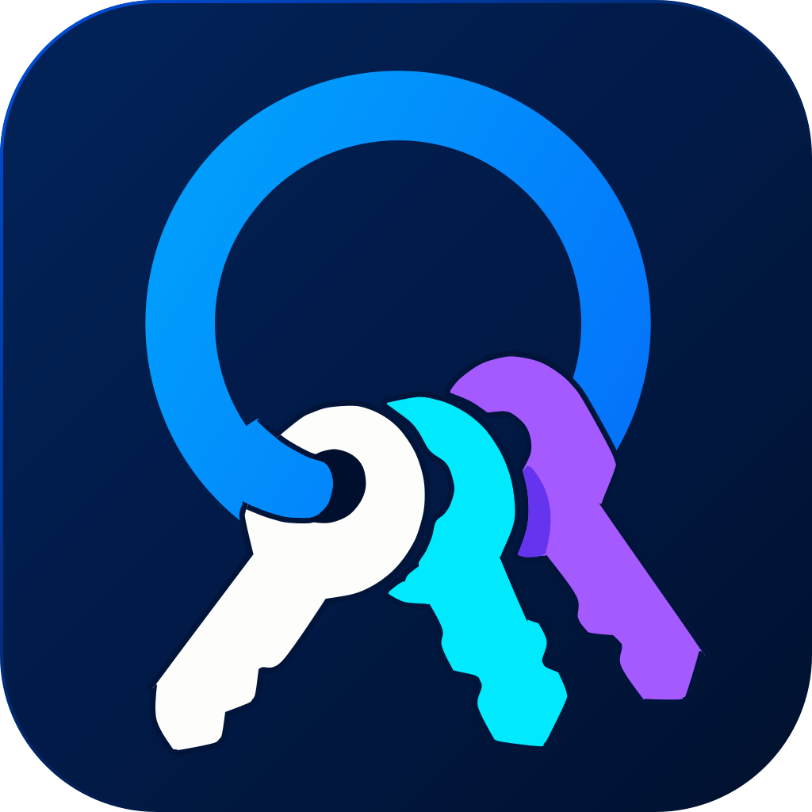
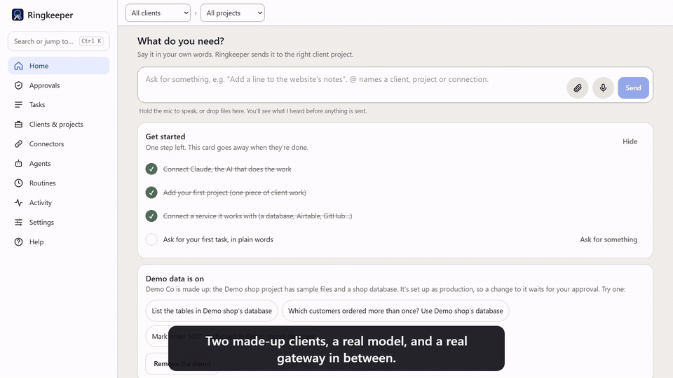
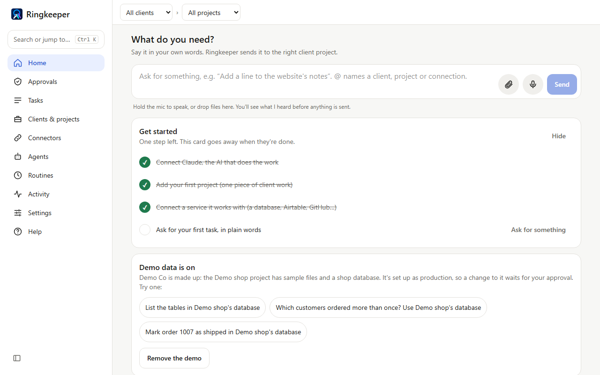
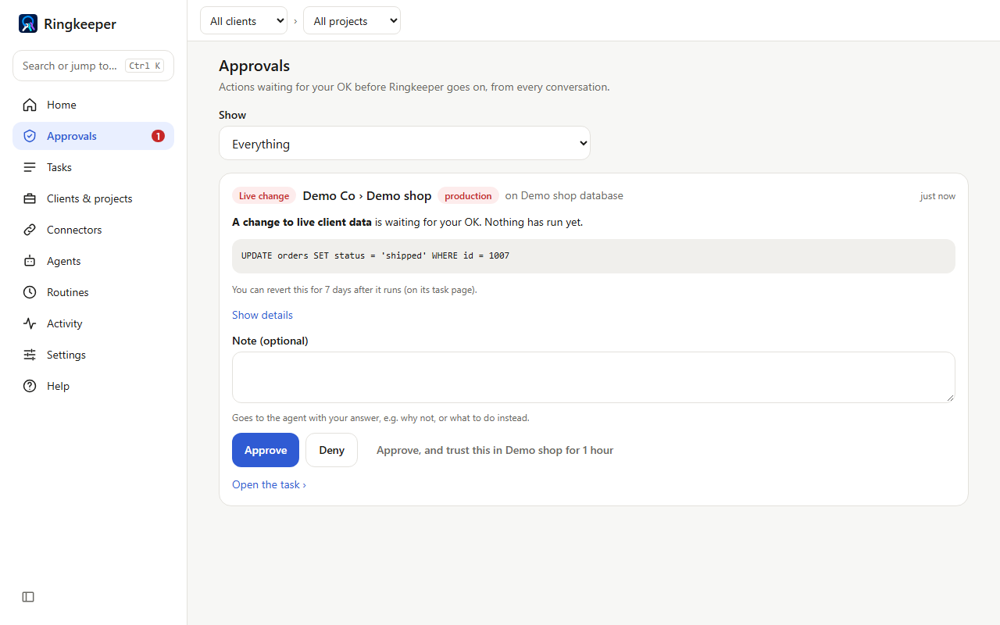
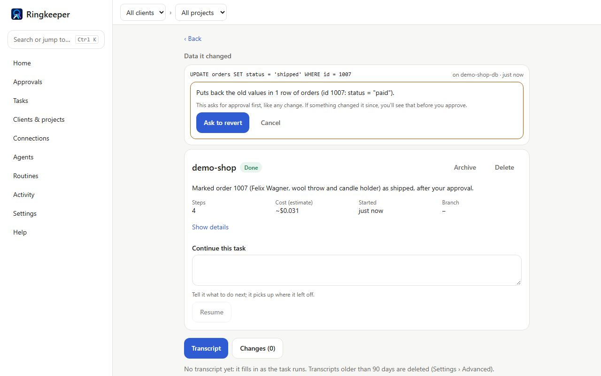

#  Ringkeeper

[Watch the 1½-minute demo](docs/media/ringkeeper-demo.mp4) (two made-up clients, a real model).

Ringkeeper lets one person get work done for many clients from one chat, without
ever switching connections.

If you work for many clients, each has its own database, Airtable, n8n, Vercel
and email. In Ringkeeper you connect each client's tools once, attach them to
that client's projects, and just ask: "Add last week's leads to General
Informatics' Airtable." It works out which client and project you mean, uses only that
project's connections, and anything that changes live data waits for your OK.

**[Download for Windows](https://github.com/alexyushkin/ringkeeper-releases/releases/latest)**
· Windows 10/11 · free and open source (MIT) · beta: SmartScreen will warn,
click **More info › Run anyway**.

On a Mac (macOS 12 or newer) there's an experimental build. It isn't signed yet, so the
first time, in Finder, choose **Go › Applications**, right-click **Ringkeeper**, and choose
**Open**. [Install steps](docs/install-desktop.md#mac-experimental).

| Ask in plain words | Approve what matters | Undo for 7 days |
| --- | --- | --- |
|  |  |  |

- Connect once per client; one client's connections can never reach another's
- Changes to live data wait for your approval; database, Airtable and n8n changes
  can be undone for 7 days
- Runs on your computer with your own Claude: no account, no Ringkeeper server
- Optional agents and routines: named helpers that run on a schedule or when something
  happens, when you'd rather not ask
- Approve from Telegram, Slack or Discord; back up and move to a new computer

**Tested on a real model:** 23 of 23 scenarios passed, with 18 of 18 requests reaching the right place, every production change held, and the other client's connection refused. Two of them push the model to reach the other client, one through a record's text and one by naming the connection, and it declined both times. Real requests through the real router, workers and gateway, against two made-up clients. Six scenarios that need real test accounts were skipped, and an earlier run that day passed 22 of 23. [Read the report](docs/scenarios/2026-11-07.md), or run it yourself: [Self-test](docs/self-test.md).

**Learn more:** [User guide](docs/README.md) · [Concepts](docs/concepts.md) ·
[Install on Windows or Mac](docs/install-desktop.md) · [Server (Docker)](docs/install-server.md) ·
[Security](docs/security.md) · [FAQ](docs/faq.md) ·
[For developers](docs/developers.md) · [Contributing](CONTRIBUTING.md) · [Roadmap](ROADMAP.md) ·
[Changelog](CHANGELOG.md)

Need help setting it up for your clients? <https://yushkin.us> or
[LinkedIn](https://www.linkedin.com/in/alexey-yushkin).

License: [MIT](LICENSE).

Logos are trademarks of their owners, used to identify integrations; no endorsement implied.
