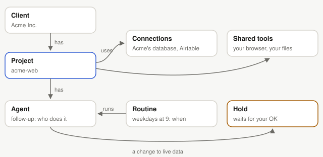

# Concepts

Ringkeeper has seven ideas. Once they click, the rest of the app follows.

**Client.** Someone you do work for, like Acme Inc. Each client's projects and
connections are kept apart from every other client's: a task for one client can
never reach another client's data.

**Project.** One piece of a client's work: a website, an app, a set of
automations. Every request goes to one project, and its task works in that
project's folder. A project has other names people use ("the Acme site"), so
Ringkeeper can tell which one you mean.

**Connection.** A client's service that their projects can use: a database,
Airtable, n8n, Vercel, GitHub, a Google account, Twilio, an MCP server.
Ringkeeper keeps the key in its vault and makes each call itself; the AI never
sees a key. A connection is marked production, staging or development.

**Shared tool.** A tool of yours that holds no client's data, like a web
browser or files on this computer. You can give it to any client's projects, or
to all of them.

**Agent.** A named helper inside one project, with instructions it always
follows and only the connections you give it. *An agent is who does the work.*

**Routine.** When an agent runs on its own: on a schedule, when something
happens (an email, a file, a webhook), or when you press Run. *A routine is when
it runs.*

**Hold.** A change to live client data (a production connection), or anything
that reaches real people (an email, a text), waits for your OK in Approvals.
Nothing happens until you approve it, and everything is logged.

## A request, start to finish

1. You ask, in plain words: "Mark order 1007 as shipped in Acme's shop."
2. Ringkeeper picks the project (it asks if it isn't sure) and starts a task.
3. The task reads what it needs through the project's connections.
4. A change to production is held. You see exactly what would run, and approve
   or deny it.
5. The task goes on with the result and reports back in the conversation.

See also: [Connections](connections.md), [Agents and routines](agents-and-routines.md),
[Approvals and safety](approvals.md).
